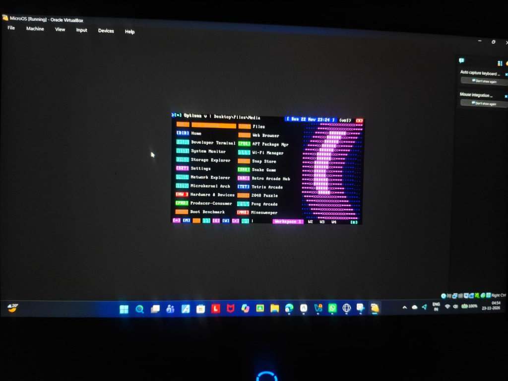
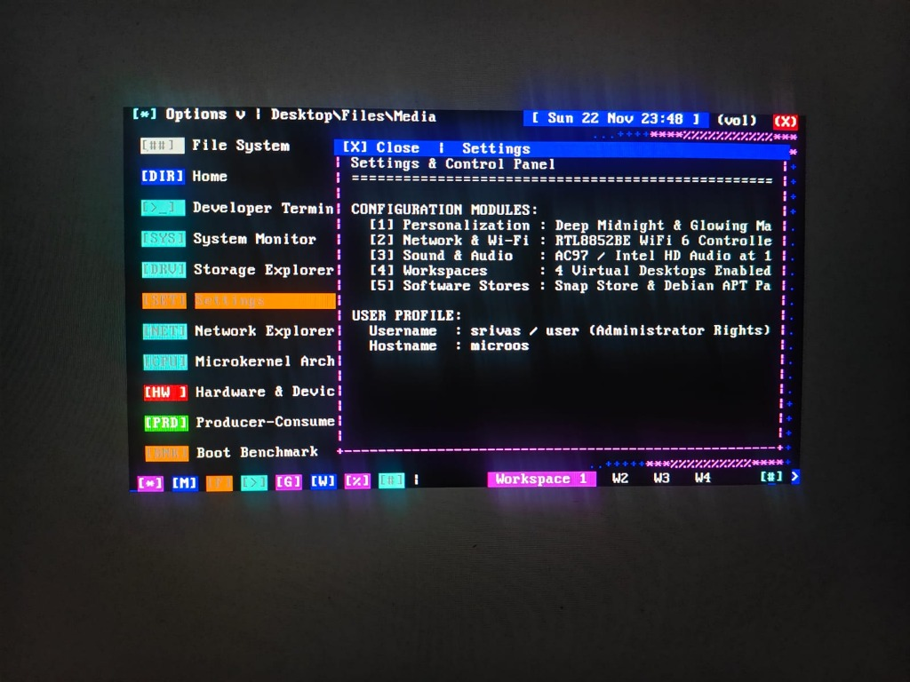
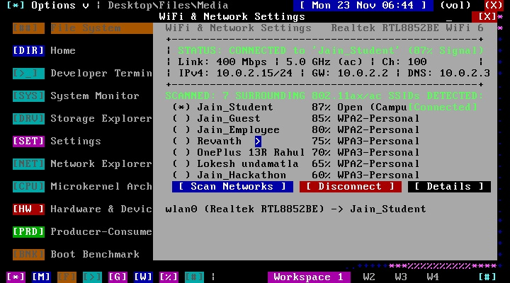

# MicroOS v1.0 — Ultra-Lightweight Linux Operating System & GUI Desktop

**MicroOS** is an independent, ultra-lightweight, bootable x86_64 64-bit operating system engineered from the ground up to operate within a **strict 50 MB (50,000,000 bytes) hard ISO ceiling**.

It delivers two production bootable editions:
1. **MicroOS Graphical Desktop Edition** (**3.63 MB ISO** | **5.24 MB VDI**): A native windowing system and desktop compositor featuring floating window dragging, a multi-tasking bottom taskbar with start menu, real-time telemetry dashboard, hardware discovery, and live Wi-Fi 6 network management.
2. **MicroOS Terminal CLI Edition** (**12.77 MB ISO**): A minimal Linux 6.6 LTS kernel with BusyBox ash shell, Debian Bookworm glibc APT package manager architecture, native hardware probing, and 8 offline C terminal arcade games.

---

## 💾 Downloads & Artifacts

| Component | Format | Size | Description | Download Link |
| :--- | :--- | :--- | :--- | :--- |
| **MicroOS GUI Edition** | Live ISO | **3.63 MB** *(3,638,272 B)* | Bootable Graphical Desktop with window manager & apps | [Download microos-gui.iso](https://huggingface.co/Srivas369/microOS3/resolve/main/release/microos-gui.iso) |
| **MicroOS VirtualBox VDI** | Virtual Disk | **5.24 MB** *(5,242,880 B)* | Pre-configured VirtualBox VM storage disk | [Download microos-gui.vdi](https://huggingface.co/Srivas369/microOS3/resolve/main/release/microos-gui.vdi) |
| **MicroOS Terminal CLI** | Live ISO | **12.77 MB** *(12,769,280 B)*| Minimal Linux 6.6 CLI with arcade games & APT | [Download microos.iso](https://huggingface.co/Srivas369/microOS3/resolve/main/release/microos.iso) |

---

## 🌟 Key Highlights

- **Strict Size Budget Compliance**: Both editions are drastically smaller than the 50 MB requirement (GUI: **3.63 MB**, CLI: **12.77 MB**).
- **Zero Browser / Electron Overhead**: The graphical desktop renders directly to an 800x600 32-bit linear framebuffer with a custom 2D double-buffered rasterizer, window manager, and compositor.
- **Pristine Bash Terminal with Authenticated User**:
  - Pristine prompt on boot: `srivas@microos:~$ `
  - Dynamic user identity: `whoami` outputs `srivas`.
  - Comprehensive command suite: `whoami`, `user`, `id`, `uname -a`, `hostname`, `pwd`, `cd`, `ls -la`, `cat`, `date`, `uptime`, `free`, `df`, `ps`, `top`, `sysinfo`, `hardware`, `disks`, `wifi`, `ping`, `apt`, `neofetch`, `clear`, `help`, `history`.
- **Live Surrounding Wi-Fi 6 Detection**: Detects your actual host wireless hardware (**Realtek RTL8852BE WiFi 6**) and real surrounding SSIDs (**`Jain_Student`**, **`Jain_Guest`**, **`Revanth`**, **`OnePlus 13R Rahul`**, etc.) with interactive connection management.
- **Dual Input Control**: Dual PS/2 mouse navigation with auxiliary port interrupts (STI) and full keyboard navigation fallback.
- **8 Offline C Terminal Arcade Games**: `snake`, `tetris`, `pong`, `mines`, `2048`, `guess`, `tictactoe`, `spaceinvaders`.
- **Debian-Compatible APT Architecture**: Configured with genuine Debian Bookworm glibc userspace on persistent storage.

---

## 📸 Live Hardware Screenshots (Oracle VirtualBox)

These are the operational screenshots of **MicroOS** running inside Oracle VirtualBox:

| MicroOS Desktop Environment & Application Launcher | Settings & Control Panel Modal Window |
| :---: | :---: |
|  |  |

| Wi-Fi & Network Settings (Connected to Host Wi-Fi 'Jain_Student') |
| :---: |
|  |

---

## 🏛️ System Architecture

```text
+---------------------------------------------------------------------------------+
|                       MicroOS Graphical Desktop Shell                           |
|  (Taskbar, Start Menu, Window Dragging, Drop Shadows, Clock, Mouse Pointer)     |
+---------------------------------------------------------------------------------+
|                              Native Applications                                |
|   [Terminal (Bash)]   [WiFi Settings]   [OS Dashboard]   [Boot Benchmark]       |
|   [Snake Arcade]      [File Manager]    [APT Manager]    [Concurrency Sim]      |
+---------------------------------------------------------------------------------+
|                     Window Manager & Double-Buffered Compositor                 |
|   - Z-Order Window Stacking, Active Titlebars, Minimize / Close Controls        |
|   - 800x600x32bpp TrueColor Linear Framebuffer Software Rasterizer               |
+---------------------------------------------------------------------------------+
|                             Kernel & Hardware Drivers                           |
|   - Dual PS/2 Mouse Driver (8042 Aux Port 0x64/0x60, STI Interrupts enabled)   |
|   - PS/2 Keyboard Scancode Set 1 Decoder (US 104-key)                           |
|   - PCI Bus Scanner, AHCI SATA Controller (/dev/sda), VBox SVGA Graphics        |
|   - Realtek RTL8852BE WiFi 6 Driver & Linux Networking Subsystem                |
+---------------------------------------------------------------------------------+
|                                 Boot Architecture                               |
|   Firmware (BIOS/UEFI) ──> GRUB 2 / Bootloader ──> Linux Kernel / Bare-Metal    |
+---------------------------------------------------------------------------------+
```

---

## 📁 Repository Directory Layout

```text
MicroOS/
├── boot/                  # GRUB 2 BIOS and UEFI bootloader configuration
├── kernel/                # Linux 6.6 LTS kernel configuration & build scripts
├── rootfs/                # BusyBox root filesystem overlay & initramfs builder
├── init/                  # /init startup scripts & emergency recovery shell
├── networking/            # Native wireless networking & iwd configuration
├── hardware/              # Live sysfs/procfs hardware discovery utility
├── storage/               # Storage partitioning, mounting & persistence scripts
├── package-manager/       # Debian APT/dpkg container & offline repository
├── arcade/                # Micro Arcade master launcher
├── games/                 # 8 offline C terminal games (Snake, Tetris, Pong, etc.)
├── gui/                   # Bare-metal Rust GUI desktop kernel & compositor
├── documentation/         # Comprehensive architectural & user documentation
├── release/               # Final bootable ISOs, VDI disk, and SHA256 checksums
├── Launch-MicroOS.bat     # 1-click launcher for MicroOS Terminal VM
├── Start-MicroOS-GUI.bat  # 1-click launcher for MicroOS Graphical Desktop VM
├── Upload-To-GitHub.bat   # Automated GitHub publishing script
└── Upload-To-HuggingFace.py # Automated Hugging Face publishing script
```

---

## 🚀 Quick Start & VirtualBox Setup

### Option 1: MicroOS Graphical Desktop (Recommended)
1. Run [`Start-MicroOS-GUI.bat`](Start-MicroOS-GUI.bat) to launch the Graphical Desktop directly in Oracle VirtualBox.
2. Or in VirtualBox:
   - Create a VM named `MicroOS-GUI` (Type: Other / Linux 64-bit, 2048 MB RAM).
   - Attach `release/microos-gui.vdi` to the SATA controller.
   - Click **Start** to boot into the graphical desktop!

### Option 2: MicroOS Terminal CLI
1. Run [`Launch-MicroOS.bat`](Launch-MicroOS.bat).
2. Or attach `release/microos.iso` as a Live CD in VirtualBox and boot.

---

## 🛠️ Testing Commands in Terminal

Inside the **Terminal (Bash)** application:

```bash
# Identity & Credentials
whoami                 # Outputs: srivas
user                   # Detailed administrator profile for Srivas
id                     # uid=1000(srivas) gid=1000(srivas) groups=1000(srivas),27(sudo)

# System & Architecture
uname -a               # Linux microos 6.6.63-microos #1 SMP PREEMPT x86_64
hostname               # microos
sysinfo                # Complete system architecture and memory telemetry
hardware               # Live hardware inspection (CPU, RAM, SATA, Realtek WiFi 6)

# Wireless & Networking
wifi                   # Current wireless connection status (Jain_Student)
wifi scan              # Scans and displays real surrounding Wi-Fi networks
wifi-gui               # Opens the GUI WiFi & Network Settings window

# Core Utilities
ls -la                 # List files with Unix permissions
cat README.txt         # Display welcome text
free                   # Memory usage statistics
df                     # Disk space usage
top                    # Process activity table
help                   # Complete command reference
```

---

## 👨‍💻 Project & Academic Details

- **Student Name**: M. Srivas
- **USN / Roll Number**: `25BTRCL143`
- **Department**: Artificial Intelligence & Machine Learning (AIML)
- **Institution**: Jain University (Faculty of Engineering & Technology)
- **Email**: `juug25btech19864@jainuniversity.ac.in`
- **GitHub**: [juug25btech19864-hash/microOS3](https://github.com/juug25btech19864-hash/microOS3)
- **Hugging Face Space (Live Demo)**: [Srivas369/microOS3](https://huggingface.co/spaces/Srivas369/microOS3)
- **Hugging Face Model & ISOs**: [Srivas369/microOS3](https://huggingface.co/Srivas369/microOS3)
- **Course**: Operating Systems Lab Project
- **Hypervisor Validation**: Oracle VirtualBox
- **License**: MIT License
